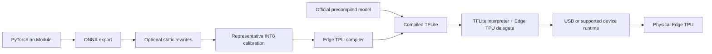

# Official Coral examples and the PyTorch frontend

Both paths ultimately run an Edge TPU-compiled INT8 TFLite graph using the same
Google runtime, delegate and physical accelerator. PyTorch is not installed or
executed inside the TPU.

| Aspect | Typical official example | torch-coral |
|---|---|---|
| Starting point | Downloaded precompiled TFLite model | PyTorch inference module and calibration inputs |
| Conversion | Already done, or TF/TFLite conversion outside the example | ONNX export, numerical layout verification, INT8 conversion, compilation |
| Inputs | PIL/NumPy, with model-specific preprocessing | float32 torch.Tensor; host layout/quantization handling |
| Device call | Interpreter.set_tensor / invoke / get_tensor | Persistent worker performs those same calls |
| Process layout | Usually one legacy SDK process | Modern frontend plus isolated compatible SDK worker |
| State | Example owns its interpreter | Modules share a serialized session and cached interpreters |
| Unsupported graph operations | Compiled graph may retain CPU operations | Rejected by default; explicit partial mode is reported |
| Extra operator coverage | Compiler-supported operations in the supplied model | Decompositions into existing operations, plus explicit bounded approximations |
| Training | Inference example | Train the source model on CPU/GPU, then recompile |
| Timing | Often invoke time only | Delegate time and IPC/host round-trip time are reported separately |

At runtime the frontend copies a tensor to CPU if necessary, serializes numeric
arrays without pickle, and sends them to the worker. The worker restores the
TFLite layout, quantizes inputs, invokes the delegate, dequantizes results and
sends arrays back. The frontend restores the PyTorch layout/output structure and
device. The host path adds overhead compared with a direct SDK call; device
compute uses the same runtime. For a fair speed comparison, use the same graph,
preprocessing, quantization, warmup, cable, negotiated USB speed and timing scope.

Some rewrites are mathematically exact before quantization, such as fixed
Cumsum and sorting-network values. Other routes change floating semantics, such
as bounded soft lookup. Both are checked against the original graph, but model
accuracy must still be evaluated on independent data. Added operations are not
new hardware kernels or firmware instructions.

Model compilation happens before inference. Errors while creating a delegate or
booting USB firmware occur before a model is loaded; changing an ONNX operator
cannot repair those failures. WinUSB pipe reset and full port/device reset are
different operations. Windows driver recovery is separate from graph conversion.

Primary references:

- [Official inference example and interpreter calls](https://gweb-coral-full.uc.r.appspot.com/docs/edgetpu/tflite-python/)
- [Edge TPU model and quantization requirements](https://gweb-coral-full.uc.r.appspot.com/docs/edgetpu/models-intro/)
- [Compiler, partial mapping and version compatibility](https://gweb-coral-full.uc.r.appspot.com/docs/edgetpu/compiler/)
- [PyCoral interpreter helper source](https://github.com/google-coral/pycoral/blob/master/pycoral/utils/edgetpu.py)

The official example is often distributed as a complete Python inference demo;
torch-coral adds a PyTorch authoring and host integration layer around that same
execution foundation. It does not make a USB Edge TPU into a Cloud TPU or GPU.
